

# AQIStudy · 空气质量数据与分析平台

**全国 389 座城市的空气质量，从此刻一直查回 2013 年 12 月**

PM2.5 实时查询 · AQI 历史数据 · 全国城市空气质量排名与分布地图 · 多维分析 · CSV 数据导出

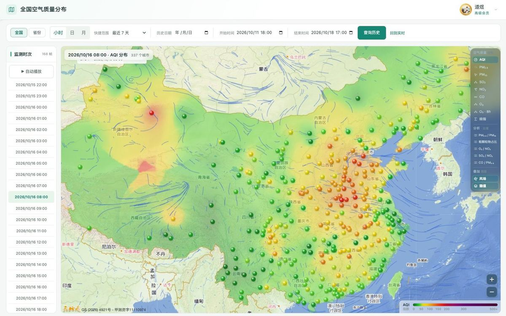

## 这是什么

AQIStudy（空气质量分析平台）是一个**在线运行的空气质量数据查询与分析平台**，运行在 <https://www.aqistudy.cn/>，浏览器打开就能用，不需要下载客户端。

它把通常要跑好几个网站才能凑齐的几件事，收进同一套界面：

| 维度 | 能查到什么 |
| --- | --- |
| **实时监测** | 全国 389 座地级及以上城市逐小时更新的 AQI、六项污染物、首要污染物与同步气象 |
| **历史数据** | 2013 年 12 月至今的逐小时实测，按小时、日均、月统计三种分辨率查看，可导出 CSV |
| **分布地图** | 全国 → 省份 → 城市 → 区县的空气质量分布，按 AQI 或六项污染物着色，支持历史时次回放 |
| **多维分析** | 相关性、风玫瑰图、城市比较、时段规律、站点分析、空气日历六个分析视角 |
| **全球模式** | CAMS 全球大气成分预报场，预报时效 0—120 小时 |

> **打开即用：<https://www.aqistudy.cn/>**

---

## 数据一览

| 项目 | 范围 |
| --- | --- |
| 城市覆盖 | 全国 389 座地级及以上城市，可继续下钻到区县 |
| 监测指标 | AQI 与 PM₂.₅、PM₁₀、SO₂、NO₂、CO、O₃ |
| 气象要素 | 气温、湿度、风速、风向、降水、能见度、气压 |
| 历史起点 | 2013 年 12 月 |
| 更新频率 | 每小时一次，实况与曲线同步刷新 |
| 时间分辨率 | 小时 / 日均 / 月统计 |
| 逐小时记录 | 城市空气质量、站点空气质量、城市气象、区县气象四类合计约 5.1 亿行 |
| 页面形态 | 纯浏览器访问，桌面与手机自适应 |

上面的记录量取的是数据库统计估算值，只用来给出一个量级概念。

---

## 七大功能模块

### 01 · 实时监测

打开就是一座城市的「此刻」：六项污染物、AQI 等级与首要污染物、天气与风，加最近 24 小时曲线；页面下半是该城市的监测站点清单与站点地图。

- **六项指标一屏看全** —— PM₂.₅、PM₁₀、SO₂、NO₂、CO、O₃ 与 AQI 同屏比较，按 AQI 等级配色，自动标出首要污染物。
- **空气和天气一起给** —— 天气现象、温度、湿度、风向风速、能见度、气压逐项列出，判断污染成因时不用再开别的站。
- **一直能看到站点级** —— 站点表可按名称搜索、按站点类型筛选、按指标排序，点一下就在右侧地图上定位到那个站点。
- **站点地图随指标切换** —— 同一张地图换看不同污染物，全市哪些片区偏高一眼分得出来。

### 02 · 历史曲线

把一座城市的空气与气象画成一条能缩放、能叠加的时间序列——从最近 24 小时，一路回到 2013 年 12 月。

- **三种分辨率** —— 小时、日均、月统计各取所需，配「最近 24 小时 / 7 天 / 30 天 / 180 天 / 1 年 / 3 年 / 5 年」快捷范围，也能自定义到具体起止时点。
- **比值曲线双轴对照** —— PM₂.₅/PM₁₀、CO/NO₂ 这类结构比值能与原始浓度叠在同一张图上，结构和浓度一次看两遍。
- **一键切气象** —— 温度、湿度、风速、降水、能见度、气压都能叠上来；风速曲线自带风向箭头，污染过程和天气过程对着看，谁先动一目了然。
- **区间统计直接标在图上** —— 所选时段的平均值与最大／最小值随范围联动，不用自己拿计算器。

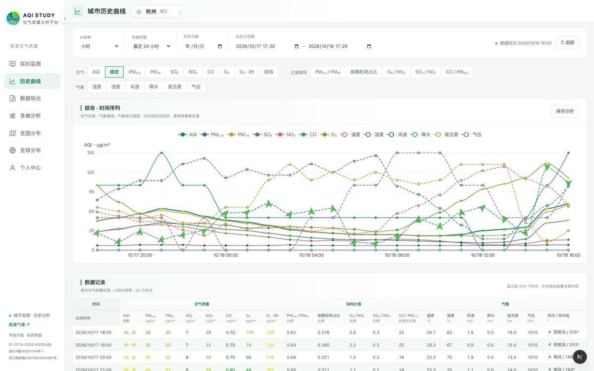

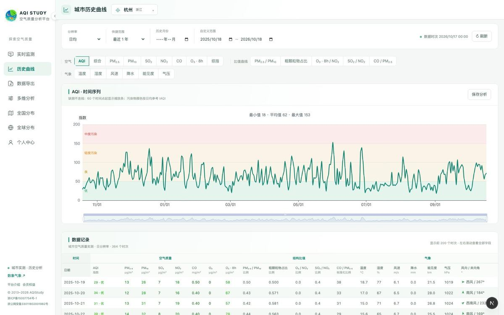

### 03 · 数据导出

把图表背后的原始数据交到手里：按城市与时间范围导出 CSV，生成后到「个人中心 → 我的数据」下载。

- **三种粒度** —— 小时、日、月三张表，覆盖六项污染物、AQI 与气象要素。
- **多指标并表** —— 一列一个指标，带单位，拿到就是能直接进表格软件的形状。
- **后台任务生成** —— 导出在服务端跑，关掉页面也不影响，跑完再回来下载。
- **额度透明** —— 每月导出次数按会员档位计，失败的任务自动退回预留额度。

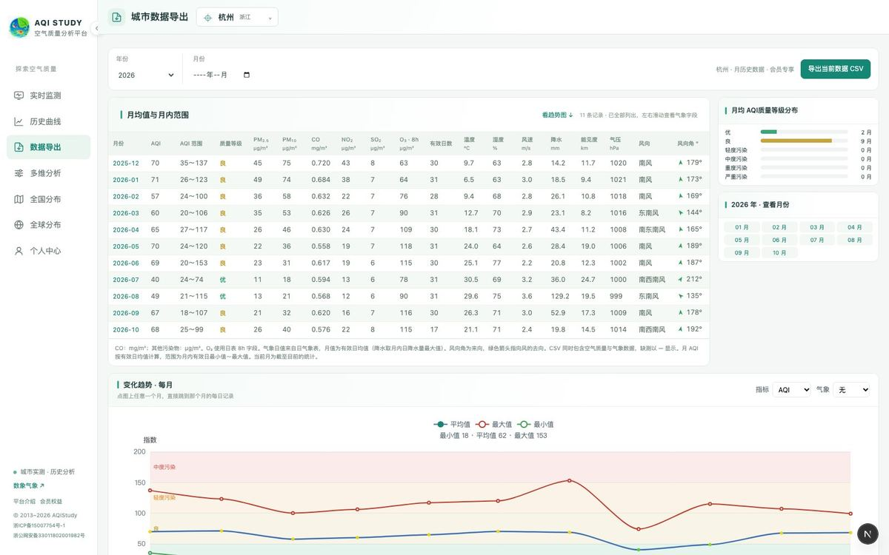

### 04 · 全国分布

把全国的城市画成一张可以按时间回放的分布图：当前这一小时，或会员范围内的任意历史时次。

- **图层自由切** —— AQI、综合指数、六项污染物与五项结构比值都能上色，还能把风场与插值色场叠上去一起看。
- **时间可回放** —— 起止时间与小时／日／月分辨率可调，支持沿时间轴自动播放，沙尘或雾霾的推进过程像放视频一样看完。
- **落到城市一级** —— 一城一色，哪一片偏高一眼看得出来；点开任意城市就能接上它的实况与历史曲线。
- **颜色口径统一** —— 全图按 AQI 等级着色，换图层也不会换掉对颜色的直觉。

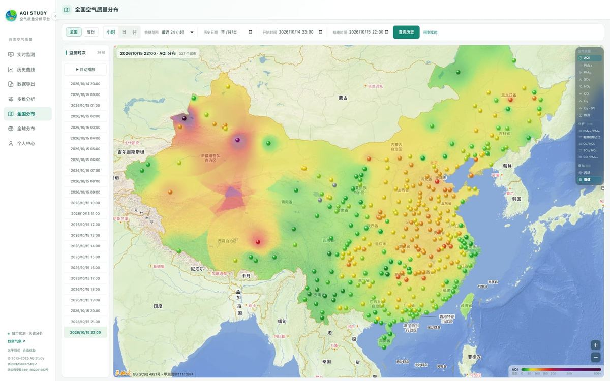

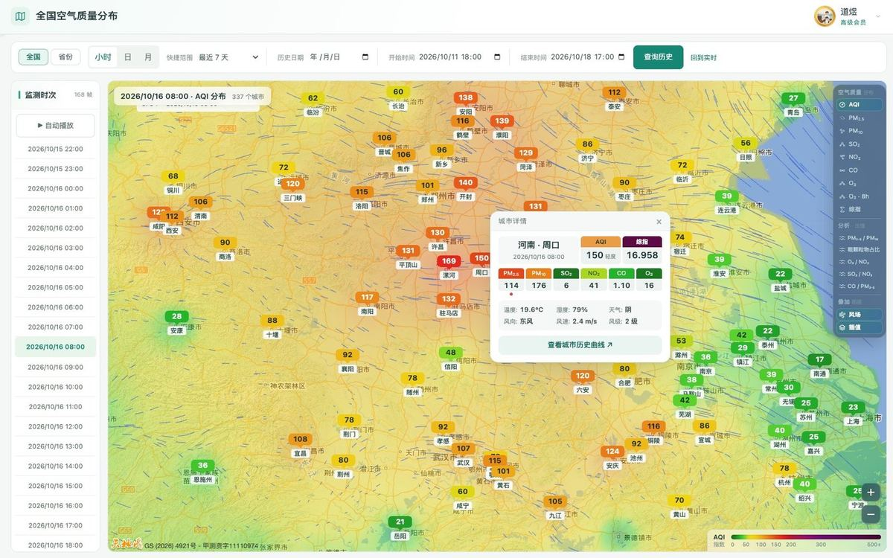

### 05 · 省份分布

把 31 个省级区域各自缩成一个数：先看省与省之间差多少，再一层层往下钻到城市、区县。

- **一省一色 + 榜单** —— 每个省级区域按域内平均 AQI 着色，右侧榜单直接按高低排好，省际差距不用自己算。
- **点开就下钻** —— 点一个省，地图立刻换成省内城市逐时对比；再点城市可继续下钻到区县。
- **与全国视图同一页** —— 顶部一键切换，两个视图共用同一套时间轴、分辨率与图层设置，切过去还是这个时次。
- **区域问题先看省** —— 省际差异与区域传输这类问题，先把省拉平再看城市，比一屏城市点更容易看出层级。

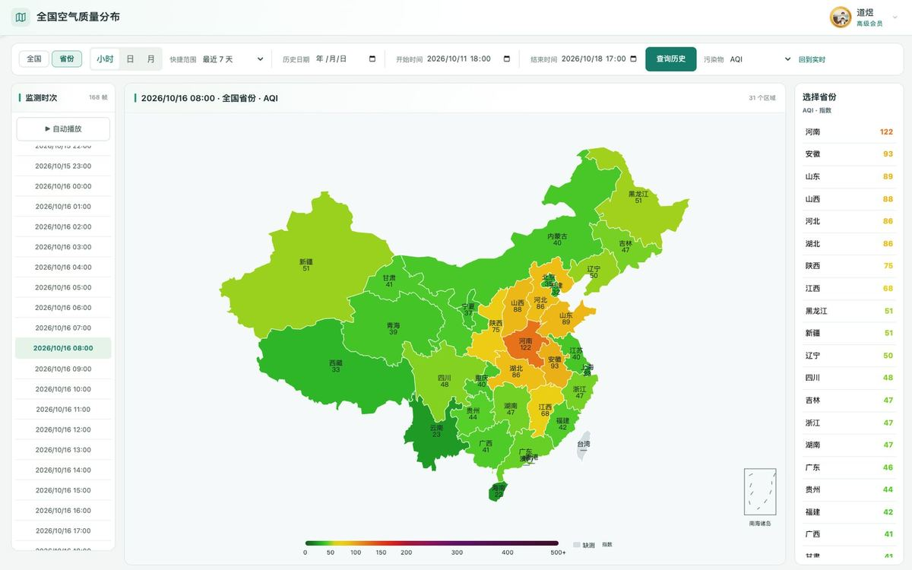

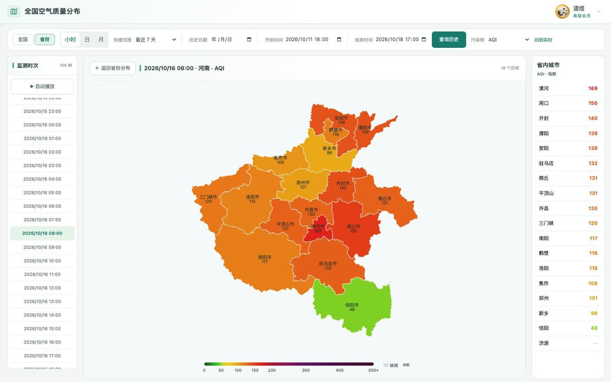

### 06 · 全球分布

地球模式下的全球空气质量预报图，由同一团队的 [数象气象（sxmap）](https://sxmap.zq12369.com/) 提供。

- **CAMS 全球预报场** —— 数据来自欧盟哥白尼大气监测服务（CAMS）的全球大气成分预报，0.4° 网格。
- **六项污染物** —— PM₂.₅、PM₁₀、SO₂、NO₂、CO、O₃；颗粒物取地表质量浓度，气体由第 137 模式层结合温度与地面气压换算为近地面质量浓度。
- **起报与时效** —— 每日 00 与 12 UTC 起报，预报时效 0—120 小时（近 48 小时逐小时，其后每 3 小时）。
- **同一套色阶** —— 按中国 AQI 技术规定的分指数断点着色，可切换指标并沿时间轴播放。

这一页是**数值模式预报场**，不是全球监测站点的实测汇总，不宜与国内站点实测直接混用比较。这一页由数象气象整屏提供，权限也归**数象气象自己的会员体系**——AQIStudy 的免费／会员任何一档都不改变这一页能看到什么。

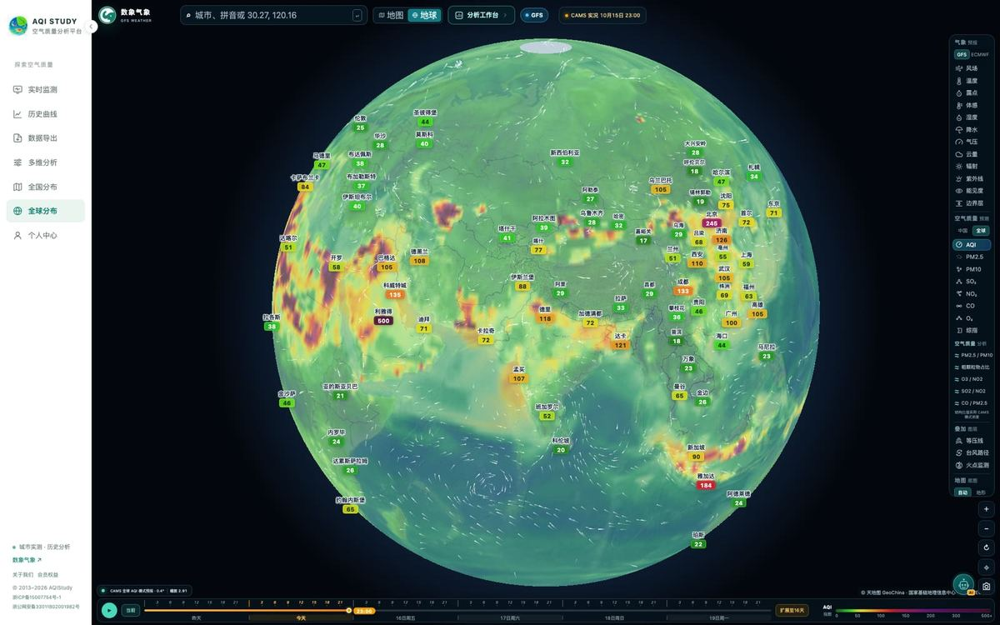

### 07 · 多维分析 · 六个视角

换个问法看数据：不只看「多少」，而看「为什么」「什么时候」「从哪个方向来的」「谁相对更高」。六个视角共用同一套公开实测数据，同屏读到的口径互相一致；除站点分析外，每个模块都能直接交给站内的 AI 助手解读。

| 视角 | 回答什么问题 |
| --- | --- |
| **相关分析** | 两项指标是不是一起涨：PM₂.₅ 与 PM₁₀ 高相关通常意味着扬尘或沙尘，CO 与 NO₂ 同步则更像机动车排放 |
| **风玫瑰图** | 污染是从哪个方向来的：一年 12 个月各铺一张玫瑰图，一眼看出季风换向 |
| **城市比较** | 多座城市同一口径横向对比，看谁高谁低、差在哪一项指标上 |
| **时段规律** | 一天 24 小时的平均变化，识别早晚高峰与夜间累积；还能按省份做整点对比 |
| **站点分析** | 一座城市的国控点铺成「监测点 × 24 小时」整点对比，看哪个点位在哪个时段明显偏高 |
| **空气日历** | 把一整年铺成一张日历，逐日按 AQI 等级上色：季节规律、一次次污染过程、哪个月最差都在同一张图里 |

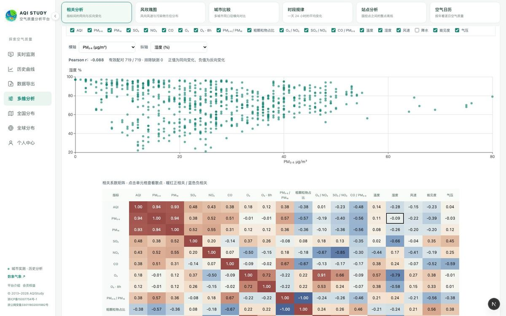

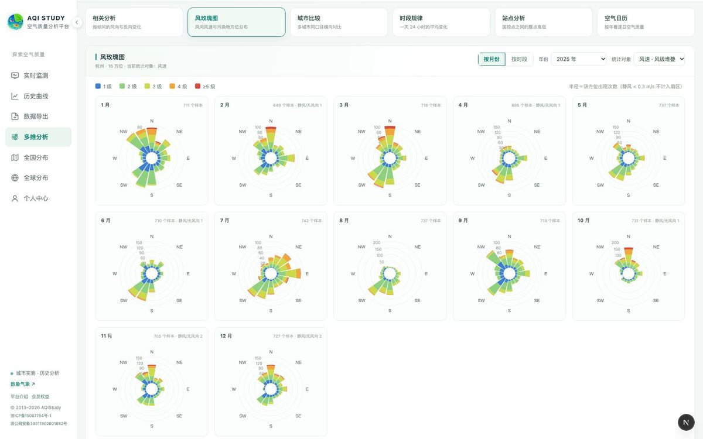

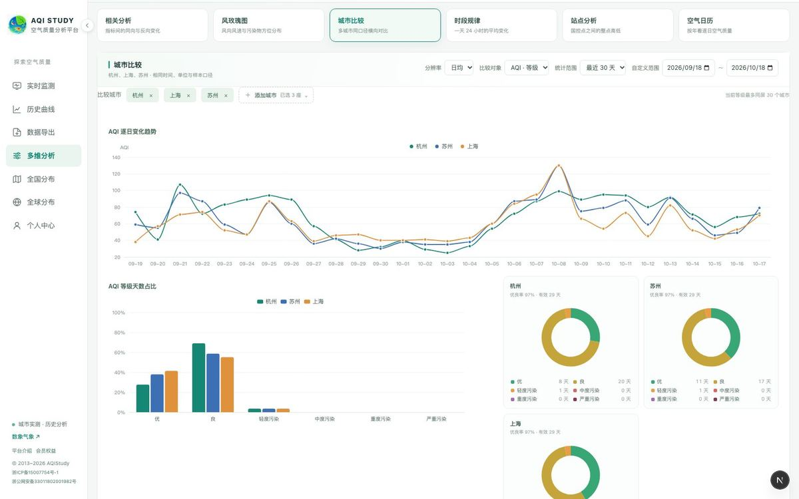

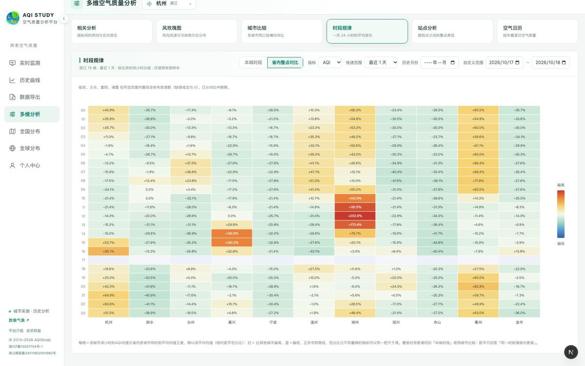

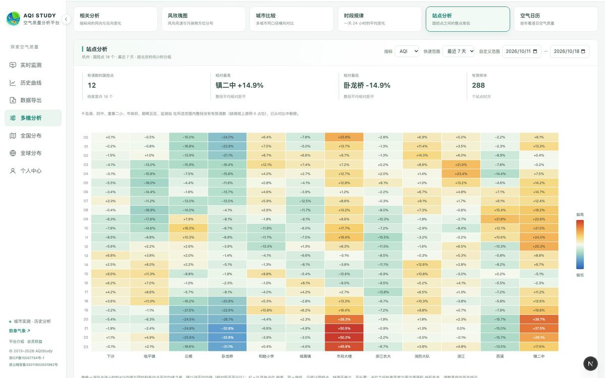

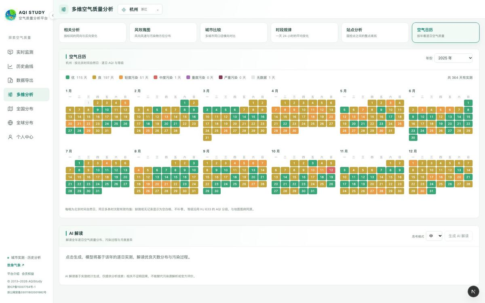

---

## 使用指南

六篇分主题的用法说明，每篇都配真实界面截图：

| 篇目 | 讲什么 |
| --- | --- |
| [实时监测怎么看](docs/01-realtime.md) | 实况卡的六项指标与首要污染物、24 小时曲线、站点表与站点地图的配合 |
| [历史曲线：三种分辨率与取值范围](docs/02-history.md) | 小时／日均／月统计的差别、快捷范围怎么选、比值曲线与气象曲线怎么叠 |
| [分布地图：全国、省份与时间回放](docs/03-map.md) | 图层与插值、历史时次回放、从全国下钻到区县的四级视图 |
| [多维分析的六个视角](docs/04-analysis.md) | 每个视角回答什么问题、默认窗口、哪些项目要会员 |
| [数据导出与 CSV 结构](docs/05-export.md) | 三种粒度导出的列结构、时间口径、任务中心与额度 |
| [全球空气质量模式预报](docs/06-global.md) | CAMS 的起报时效、六项污染物换算口径、与站点实测的区别 |

---

## 数据尺度一览

| 项目 | 范围 |
| --- | --- |
| 城市 | 全国 389 座地级及以上城市 |
| 行政区划下钻 | 全国 → 省份 → 城市 → 区县 |
| 空气质量指标 | AQI + 六项污染物（PM₂.₅ / PM₁₀ / SO₂ / NO₂ / CO / O₃） |
| 结构比值 | PM₂.₅/PM₁₀、粗颗粒物占比、O₃/NO₂、SO₂/NO₂、CO/PM₂.₅ |
| 气象要素 | 温度、湿度、风速、风向、降水、能见度、气压 |
| 时间分辨率 | 小时 / 日均 / 月统计 |
| 历史深度 | 2013 年 12 月至今（按会员档位开放回看范围） |
| 逐小时记录 | 四类数据合计约 5.1 亿行 |
| 更新频率 | 每小时 |
| 全球模式 | CAMS，0.4°，0—120 小时 |

---

## 使用方式

1. 打开 <https://www.aqistudy.cn/>
2. 在顶部选择城市（可按城市名搜索），或直接进入分布地图
3. 看实时监测：六项污染物、AQI 等级与首要污染物、最近 24 小时曲线
4. 需要更长时段就进「历史曲线」：选分辨率、选范围，或自定义起止时点
5. 要看全省／全国格局就进「分布地图」：切图层、拖时间轴、必要时开插值与风场
6. 需要原始数据就进「数据导出」：按城市与范围生成 CSV，到个人中心下载

未登录可以直接看到实时数据与部分公开页面；**注册免费账号后可以查看最近 24 小时的逐小时曲线与多维分析的默认视图**。更长的历史跨度、同屏多城市对比、CSV 导出额度与空气日历按会员档位开放，每一档具体给多少，都写在官网 [会员与权益](https://www.aqistudy.cn/membership) 页的对照表里。

> 会员方案与赠送时长以官网页面实时展示为准，本仓库不做承诺。

---

## 适用场景

| 场景 | 怎么用 |
| --- | --- |
| **日常出行** | 出门前看实时 AQI 与首要污染物，决定要不要戴口罩、适不适合开窗与户外运动 |
| **污染过程复盘** | 用历史曲线叠加风场与湿度，看浓度峰值和气象条件谁先动 |
| **环境研判与环评** | 导出逐小时或日均 CSV，做长周期统计与建模；用相关分析判断污染类型 |
| **科研与教学** | 城市比较、时段规律、风玫瑰图与空气日历，直接当教学素材与论文配图 |
| **区域传输分析** | 省份分布看省际差异，全国分布按时间回放看污染带的推进方向 |
| **数据留档与报表** | 按月导出并表 CSV，用于月报、年报与合规留档 |

---

## 常见问题

**AQIStudy 是什么？免费吗？**
AQIStudy 是在线空气质量数据查询与分析平台，网址 <https://www.aqistudy.cn/>。注册免费账号即可查看实时数据、最近 24 小时的逐小时历史曲线与多维分析的默认视图；更长的历史跨度、多城市对比与 CSV 导出按会员档位开放。

**PM2.5 历史数据能查多久？**
数据自 2013 年 12 月起连续收录，可以一直查到昨天。能回看多远取决于账号档位，具体跨度见官网会员对照表。

**数据多久更新一次？**
源数据每小时更新一次，实况与曲线同步刷新。每一帧都标着对应时次，不会出现「看不出这是几点数据」的情况。

**空气质量数据能下载成 Excel 吗？**
可以。数据导出提供 CSV（Excel 可直接打开），按城市与时间范围生成，分小时、日、月三种粒度，一列一个指标并带单位。

**能查哪些城市？区县能查吗？**
全国 389 座地级及以上城市，可以从全国视图下钻到省份、城市与区县，也能查具体监测站点。

**分布地图是实测还是插值？**
城市点是站点／城市实测，色场是在实测点上做的空间插值，用来帮助看趋势；插值可以单独关闭，只看城市点。

**全球分布是实测数据吗？**
不是。全球分布是 CAMS 数值模式预报场（0.4° 网格，0—120 小时），与国内站点实测口径不同，不能直接混用比较；这一页由数象气象提供，需要数象气象的账号与会员权限，AQIStudy 的会员不含这一项。

**数据来源与版权？**
平台由杭州真气科技有限公司运营（浙ICP备15007754号-1），数据来自公开的空气质量与气象监测资料，具体口径以页面标注为准。

**手机能用吗？**
可以。页面自适应桌面与手机浏览器。

---

## 相关链接

| 页面 | 地址 |
| --- | --- |
| 首页 · PM2.5 实时查询与空气质量指数 | <https://www.aqistudy.cn/> |
| 平台介绍 · 七大功能模块 | <https://www.aqistudy.cn/platform> |
| 全国空气质量分布地图 | <https://www.aqistudy.cn/map> |
| 城市空气质量与气温历史曲线 | <https://www.aqistudy.cn/history> |
| 空气质量与气象数据下载导出 | <https://www.aqistudy.cn/history-data> |
| 多维空气质量分析 | <https://www.aqistudy.cn/analysis> |
| 全球空气质量分布与模式预报 | <https://www.aqistudy.cn/global> |
| 会员与权益 | <https://www.aqistudy.cn/membership> |

同一团队的另一款产品：[数象气象 · sxmap](https://sxmap.zq12369.com/)（全球天气、台风路径、卫星火点地图），介绍见 [sxmap-weather](https://github.com/wangjiezju1988/sxmap-weather)。

---

## 说明

- 本仓库是**产品功能说明页**，用于介绍 AQIStudy 的功能与使用方式，不包含产品源代码。
- 文中截图取自平台真实界面，界面细节可能随版本迭代调整，请以线上页面为准。
- 空气质量与气象数据来自公开监测资料与数值模式，页面会标注数据时次与口径；本站不提供预警发布，也不构成任何形式的专业建议，预报与健康提示请以官方发布为准。

---

## About

**AQIStudy** is a browser-based platform for querying and analysing air quality data across China — real-time readings, hourly history back to December 2013, national and provincial distribution maps, multi-dimensional analysis, and CSV export.

- **Real-time monitoring** — hourly AQI, PM₂.₅, PM₁₀, SO₂, NO₂, CO and O₃ for 389 prefecture-level cities and above, with primary pollutant, weather, wind and monitoring-station detail.
- **Historical series** — hourly, daily and monthly resolutions from December 2013 to now, with ratio curves, weather overlays and range statistics.
- **Distribution maps** — national, provincial, city and county views, coloured by AQI or any pollutant, with wind and interpolation overlays and time playback.
- **Multi-dimensional analysis** — correlation, wind rose, city comparison, diurnal pattern, station comparison and air-quality calendar, each with an AI reading panel.
- **Global forecast** — CAMS global atmospheric composition forecast at 0.4° for the next 120 hours (model output, not station observations).
- **Data export** — CSV by city and time range in hourly, daily or monthly granularity, with a background task centre.

Try it here: **<https://www.aqistudy.cn/>**

如果这个平台对你有用，欢迎给本仓库点一个 Star ⭐，也欢迎把它分享给需要查空气质量数据的朋友。
