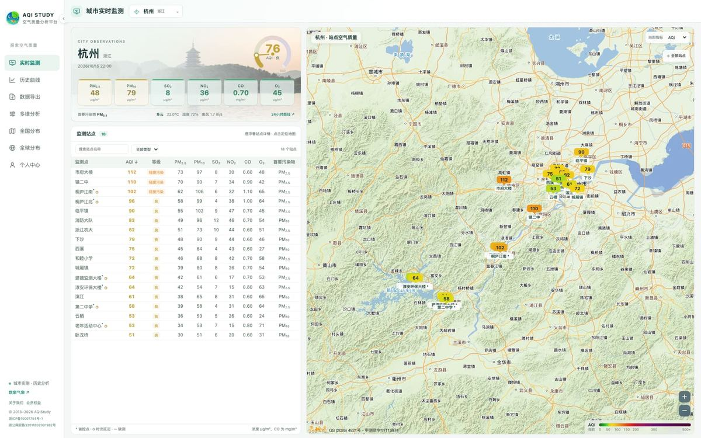

# 实时监测怎么看

> 对应页面：<https://www.aqistudy.cn/> 首页 · 实时监测

实时监测回答的是最短的一个问题：**这座城市的空气，现在怎么样。** 页面把答案拆成四块——实况卡、24 小时曲线、站点表、站点地图，四块看的是同一座城市、同一个时次。

## 一、实况卡：六项指标 + AQI

卡片顶部先给结论：当前 AQI 数值、等级与配色、首要污染物。然后是六项污染物：PM₂.₅、PM₁₀、SO₂、NO₂、CO、O₃。

三处口径要注意：

- **单位不统一**。CO 用 mg/m³，其余五项用 μg/m³，AQI 是无量纲指数。混着读容易把 CO 的 0.8 当成「很低」，其实它对应的是常规城市背景水平。
- **等级颜色全站同一套**。AQI 六级（优、良、轻度污染、中度污染、重度污染、严重污染）的颜色是固定的，地图、曲线、日历用的是同一份色阶，换页面不会换掉对颜色的直觉。
- **首要污染物是上游给的字段**。AQI 大于 50 时才有首要污染物；AQI 很低时这一格通常为空，页面显示「—」，不要当成缺数据。

## 二、天气和空气一起给

实况卡同时列出天气现象、温度、湿度、风向风速、能见度、气压。

为什么要把气象放在同一张卡上：污染浓度的高低，一半取决于排放，一半取决于气象。同样是静稳天气，湿度 40% 和 90% 对应的颗粒物增长机制完全不同；同样是风，2 m/s 和 6 m/s 对扩散的作用差一个量级。判断成因时不必再开第二个网站。

## 三、最近 24 小时曲线

实况卡下方是这条城市最近 24 小时的逐小时曲线，AQI 与六项污染物可以单独开关。

用法上建议先看 AQI 的形状，再看是哪一项在推着它走：

| 曲线形状 | 通常意味着 |
| --- | --- |
| 夜间抬升、午后回落 | 边界层日变化主导，常见于秋冬季的颗粒物 |
| 午后单峰、夜间低 | 光化学反应主导，O₃ 的典型形态 |
| 与风速曲线反向 | 扩散条件主导，风一起来浓度就掉 |
| 与湿度同步抬升 | 吸湿增长或二次生成，颗粒物粒径会长 |

需要更长时段就点进「历史曲线」，见[《历史曲线：三种分辨率与取值范围》](02-history.md)。

## 四、站点表与站点地图

页面下半是这座城市所有监测站点的清单和地图。

- **站点表**可以按名称搜索、按站点类型筛选、按任一指标排序。找「今天最脏的是哪个点」时，直接按 AQI 降序即可。
- **点表格里的一行**，右侧地图会定位到那个站点，站点的最近读数跟着出来。
- **站点地图随指标切换**：换看 PM₁₀ 或 O₃ 时，偏高片区的分布会变——同一个城市里，颗粒物偏高往往在工业与交通走廊，O₃ 偏高常在城区下风向。

站点级数据的意义在于它比城市平均值更细。城市平均值是全市点位的汇总，遇到「全市 80、但你家门口 130」这种情况，只有站点表能解释。

## 五、三条容易踩的坑

1. **一个城市的「实时」不是同一秒**。各站点上报时次可能相差几分钟到一小时，页面按最近有效时次展示，卡片上标的是这个时次，不是服务器当前时间。
2. **缺测显示为「—」，不是 0**。缺测与 0 是两件事，0 会拉低平均值，页面不会用 0 填充。
3. **AQI 与浓度不是线性同增**。AQI 是按分指数断点换算的，浓度翻倍往往不会让 AQI 翻倍，别拿 AQI 的差值当浓度差值用。

## 相关页面

- [历史曲线：三种分辨率与取值范围](02-history.md)
- [分布地图：全国、省份与时间回放](03-map.md)
- [多维分析的六个视角](04-analysis.md)
- 在线使用：<https://www.aqistudy.cn/>
